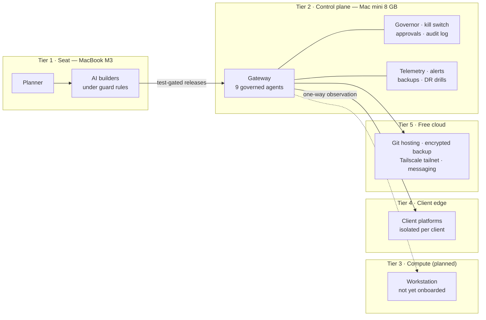
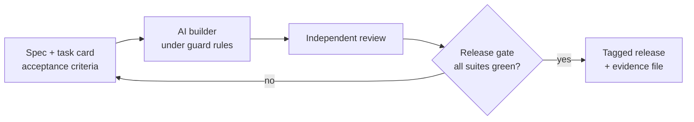

# Empire OS — reference architecture

**How one person runs 9 governed AI agents on a 2012 Mac mini with 8 GB of RAM — and ships test-gated releases: eight in seven days, v1.0.0 → v1.3.0.**

This repository documents the *architecture* of Empire OS, a self-hosted multi-agent AI operating system in daily production use. It is a reference, not the engine: it explains the tiers, the governance model, the release process and the trade-offs, so you can apply the patterns to your own system. No engine code, agent prompts, configurations, client data or credentials are published here.

## At a glance

| Measure | Value | Evidence |
|---|---|---|
| Governed agents in production | 9 | live fleet, release notes |
| Commits (Oct 2026) | 626 | private repository history |
| Releases | 8 in 7 days (v1.0.0 → v1.3.0, 13 Oct 2026) | tagged releases |
| Release-gate suites | 99 / 99 passed at v1.3.0 (gate grew from 48 suites) | promotion report |
| Automated tests | 1,026 passing, 0 failing (v1.3.0) | test run |
| Pre-release browser sweep | 116 pages, no priority-1 defects | sweep report |
| Control-plane host | 2012 Mac mini, 8 GB RAM | — |
| Heartbeat tokens | 12.0 M → 1.0 M a day (−91%) | token telemetry |
| Disaster-recovery rebuild | 127 GB SHA-verified capsule, zero data loss | DR drill record |

## The five tiers

| Tier | Role | Key constraint |
|---|---|---|
| 1 · Seat | Where plans and code are written. AI builders work only from task cards with acceptance criteria. | Builders never touch production directly. |
| 2 · Control plane | Runs the agent gateway, the RAM governor, the kill switch, approvals, telemetry and backups. | 8 GB RAM: every process has a written budget. |
| 3 · Compute | Heavier jobs, when onboarded. | Planned; not yet in service. |
| 4 · Client edge | Each client system runs on its own node. | The control plane observes; it never writes into client systems. |
| 5 · Free cloud | Git hosting, encrypted off-site backup, private network, notifications. | Free tiers only; no single provider is load-bearing. |

Full detail: [docs/architecture.md](docs/architecture.md).

## Governance in one table

| Control | What it does |
|---|---|
| Autonomy levels L0–L4 | Each agent action is classed from "suggest only" to "act and report". |
| Risk classes R0–R4 | Higher risk needs a human approval tier before it runs. |
| Kill switch | Freezes agent processes from a messaging command or the CLI. |
| Append-only audit log | Records every approval, change and release. |
| RAM governor | Defers non-urgent work under memory pressure (about 12 deferrals a week, no crashes). |
| Standards mapped | OWASP Top 10 for Agentic Applications, NIST AI RMF, ISO/IEC 42001, India DPDP Act 2023. |

Full model: [docs/governance.md](docs/governance.md).

## How releases happen

Details: [docs/release-process.md](docs/release-process.md).

## Decisions

Architecture decisions are recorded as ADRs in [docs/adr/](docs/adr/):

- [ADR-001](docs/adr/ADR-001-constrained-control-plane.md) — run the control plane on an 8 GB machine, on purpose
- [ADR-002](docs/adr/ADR-002-one-way-observation.md) — the control plane observes client systems but never writes to them
- [ADR-003](docs/adr/ADR-003-test-gated-releases.md) — no tag without every gate suite green

## What is deliberately not here

The engine, the governor's implementation, agent prompts and configurations, internal dashboards, and every client or clinical module stay private. This repository is released through the five-gate [Sterile Field](https://github.com/sterilefield) release check: allow-list, secret and deny-list scan, fresh history, independent review, owner gate.

## Author

**Dr. Ravi Teja Thiriveedhi** — clinician turned AI systems architect; 20 years of clinical practice and hospital operations. [GitHub](https://github.com/Raviteja2k2k) · [LinkedIn](https://www.linkedin.com/in/dr-ravi-teja-clinical-ai)

## Licence

Documentation in this repository is licensed under [CC BY-NC-ND 4.0](LICENSE): share it with credit, no commercial use, no derivatives. The scripts in `scripts/` are small helpers you may reuse.
